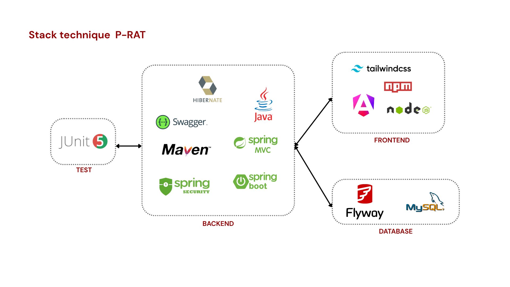

# Journal de projet — P-RAT

**Module :** ALTN72 — 2026-27 · **Groupe :** Antoine Roucau, Clothilde Proux · **Dépôt :** https://github.com/TorielLink/P-RAT

---

## 1. README

**Prérequis :** Java 21+ (testé avec Java 25), Maven, MySQL 8, Node.js + npm (Angular CLI).

**Base de données :** créez simplement une base vide (`CREATE DATABASE p_rat_db;`). Au premier démarrage, Flyway crée le schéma et charge les données de démonstration (V1 à V7). Les identifiants MySQL sont lus dans `DB_USERNAME` (par défaut `root`) et `DB_PASSWORD` (obligatoire, jamais dans Git).

| Partie | Commande | Adresse |
|---|---|---|
| Back | `mvn spring-boot:run` | http://localhost:8080 |
| Front | `npm install` puis `ng serve` | http://localhost:4200 |
| API | Swagger UI (après connexion) | http://localhost:8080/swagger-ui.html |

Le proxy Angular redirige `/api` vers le port 8080. Application déployée : https://… *(profil `prod` prêt)*.

**Comptes de test** (mot de passe `demo123`) :

| Login | Profil | Entreprise |
|---|---|---|
| `admin` | Admin | — |
| `agent`, `agent2` | Agent de terrain | — |
| `prestataire` | Prestataire | Maintenance Démo |
| `ascenseurs` | Prestataire | Ascenseurs Express |
| `video` | Prestataire | Vidéo Services |
| `escaliers` | Prestataire | Escaliers Mécaniques Services |
| `portes` | Prestataire | Portes & Accès Sécurité |

**Limites connues :** le journal des événements est stocké dans des fichiers texte plutôt qu'en base, et la protection CSRF est désactivée.

---

## 2. Architecture

**Back (Spring Boot)** — une architecture en couches :

- `controller` expose les endpoints REST, sans aucune règle métier ;
- `service` porte les règles métier et les droits sur chaque ressource (une interface par service) ;
- `model` contient les entités JPA ; les règles propres à un incident vivent dans l'entité (`estModifiablePar`, `affecterA`…) ;
- `repository` (Spring Data JPA), `dto` (on n'expose jamais les entités), `exception`, `config` et `logs` (journal).

Le schéma MySQL est géré uniquement par Flyway (`ddl-auto=validate`).

**Front (Angular)** — `core` (services HTTP, authentification, guards), `layout` (bandeau), `pages` (un écran par page) et `shared` (pipe des libellés et composants réutilisés).

---

## 3. Tests

Nous avons privilégié des **tests unitaires sans base de données** (`mvn test`, 83 tests), sur trois niveaux :

- **le modèle** (JUnit) : règles de modification, d'affectation, d'évaluation et seuils RG3 ;
- **les services** (Mockito) : règles métier, droits et ordre des contrôles (404 → 409 → 403) ;
- **les contrôleurs** (`@WebMvcTest`, `@WithMockUser`) : codes HTTP, droits par profil, validation et format des erreurs.

L'horloge est figée (`Clock.fixed`) pour pouvoir vérifier les durées et les seuils de 48 h / 72 h. Le front Angular et le journal en fichiers ont été testés à la main.

---

## 4. Choix techniques

### Droits par profil

| Fonctionnalité | Admin | Prestataire | Agent |
|---|:---:|:---:|:---:|
| Stations (F2–F3) | WL | X | L |
| Équipements (F2–F3) | WL | L (ses incidents) | WL |
| Changer l'état d'un équipement | WL | WL (ses incidents) | WL |
| Déclarer un incident (F4) | WL | X | WL |
| Consulter un incident (F5) | L | L (les siens) | L |
| Modifier un incident (F6) | WL (non résolu) | X | WL (les siens, non affectés) |
| Affecter un prestataire (F7) | WL | X | X |
| Résoudre un incident (F8) | WL | WL (les siens) | X |
| Historique (F9) | L | L (les siens) | L |
| Évaluer un prestataire (F10) | WL | L (ses évaluations) | X |
| Tableau de bord (F11) | L | L (les siens) | X |
| Carte (alpha 4) / Journal (alpha 5) | L | X | X |

*WL : lecture et écriture — L : lecture — X : aucun accès*

Les droits sont vérifiés **deux fois** : `SecurityConfig` filtre par profil et par URL (403), puis les services contrôlent la ressource elle-même. Quand un prestataire demande l'incident ou l'équipement d'une autre entreprise, il reçoit un 404 plutôt qu'un 403, pour ne pas en révéler l'existence. Côté Angular, les guards ne servent qu'au confort d'affichage : la vraie protection reste sur le serveur.

### Nos grands choix

- **Les exceptions** sont traduites à un seul endroit (`@RestControllerAdvice` + `ProblemDetail`) : toutes les erreurs ont le même format JSON avec un message en français, et les services ignorent tout de HTTP.
- **Les transactions** : `readOnly` par défaut sur chaque service, `@Transactional` sur chaque écriture (RG10, tout ou rien).
- **Aucune requête SQL native** : uniquement des requêtes dérivées et du JPQL, vérifiés au démarrage et à paramètres liés.
- **L'horloge est injectée** (`Clock`) : les dates sont toujours fixées par le serveur, et les seuils deviennent testables.
- **La durée et le niveau d'attention sont calculés à chaque lecture**, jamais stockés, avec des seuils définis une seule fois (`SEUIL_ORANGE`, `SEUIL_ROUGE`).
- **Des DTO en liste blanche** : le client ne peut envoyer que les champs autorisés. Par exemple, une modification (`PATCH`) ne contient que la description et la priorité.
- **La validation est faite deux fois** : Bean Validation côté serveur (la vraie garantie), puis reprise dans Angular pour le confort.

### SOLID

- **SRP** : chaque classe a un rôle (le journal est découpé entre un écrivain et un lecteur).
- **OCP** : le journal écoute des événements publiés par `IncidentService`, ce qui permet d'ajouter un écouteur sans modifier le service.
- **ISP** : une interface par domaine.
- **DIP** : les contrôleurs dépendent d'interfaces, et l'horloge est injectée.
- **LSP** n'a pas été retenu : nous n'avons pas de hiérarchie d'héritage.

### Authentification

Nous avons choisi une **session avec cookie** plutôt qu'un JWT : grâce au proxy Angular, le front et le back partagent la même origine, et le navigateur gère le cookie tout seul. Les mots de passe sont hachés avec **BCrypt**, et les refus (401 / 403) sont renvoyés en JSON avec un message clair. Le CSRF est désactivé, une simplification que nous assumons, atténuée par le cookie `SameSite=Lax`.

### Fonctionnalités

- **Modifier un incident (F6)** — on peut corriger ce que le déclarant a saisi (description, priorité), mais pas ce que le serveur a fixé (équipement, dates, statut). Un incident résolu n'est plus modifiable par personne.
- **Affecter un prestataire (F7)** — affecter et réaffecter sont la même opération ; l'incident passe alors « Pris en charge ».
- **Résoudre un incident (F8)** — la date est fixée par le serveur, et un incident déjà résolu renvoie 409.
- **Historique (F9)** — les incidents résolus sont paginés, et les notes sont chargées en une seule requête pour éviter le problème N+1.
- **Évaluer un prestataire (F10)** — une note de 1 à 5 et une seule évaluation par incident (contrôle dans le service et contrainte en base). La moyenne est calculée à la volée en JPQL.
- **Tableau de bord (F11)** — les incidents non résolus, du plus ancien au plus récent, avec leur niveau d'attention.

### Interface et données

- Un **thème sombre** dont toutes les couleurs sont des variables CSS ; les couleurs porteuses de sens respectent le contraste WCAG AA.
- Un **jeu de démonstration** (V7, généré par un script Python) : 15 stations, 71 équipements, 105 incidents, 49 évaluations et 7 prestataires.

---

## 5. Lot alpha

### Carte du réseau (alpha n°4)

Elle permet à l'Admin de voir d'un coup d'œil où se trouvent les incidents. Nous avons choisi une **grille** plutôt qu'une vraie carte : chaque station a une position (migration V6), et sa couleur reflète le niveau le plus grave de ses incidents actifs. Deux stations ne peuvent pas occuper la même case.

- **Difficultés :** la gestion des stations sans coordonnées. Nous avons rendu la position facultative (les deux coordonnées ou aucune) et ajouté une liste « Hors carte » sous la grille.
- **Reste à faire :** passer sur une vraie carte, placer les stations de façon cohérente avec la réalité, et éventuellement les relier entre elles par des lignes.

### Journal des événements (alpha n°5)

Il permet de savoir qui a fait quoi, et quand, sur un incident : déclaration, modification, affectation, résolution et évaluation. `IncidentService` publie un événement, que `JournalIncidentListener` écrit **après la validation de la transaction** : rien n'est tracé si l'action échoue. Chaque incident a son propre fichier texte, que l'Admin consulte dans le détail de l'incident, du plus récent au plus ancien.

- **Limites :** le chemin des fichiers dépend du dossier de lancement, et le journal n'est pas sauvegardé avec la base.
- **Reste à faire :** stocker le journal dans une table.

### Easter egg

Tapez le Konami code (↑ ↑ ↓ ↓ ← → ← → B A) : une rame traverse l'écran au son d'un carillon. Tout se passe côté front, sans aucun appel au serveur.

---

## 6. Sécurité

| Domaine | Mesure |
|---|---|
| Mots de passe | BCrypt, uniquement des hachés dans les migrations |
| Accès | 401 sans session, droits dans `SecurityConfig` et dans les services |
| Connexion | un message unique, « Identifiant ou mot de passe incorrect » ; les comptes inactifs sont refusés |
| XSS / injection SQL | Angular échappe tout ; requêtes à paramètres liés uniquement |
| Secrets | identifiants de base en variables d'environnement |
| Session | cookie `HttpOnly`, `SameSite=Lax`, expiration après 30 min, `Secure` en production |
| Erreurs | aucune trace technique dans les réponses |

---

## 7. Bilan

**Contribution :** le travail a été réparti à parts égales (50 / 50).

**Nos principales difficultés :**

- **Les débuts avec Apache** et la mise en place de l'ensemble du site (base, back, front).
- **Flyway** : on ne modifie jamais une migration déjà appliquée, et on arrête le back avant d'en créer une (DevTools en avait appliqué une vide).
- **Git** : le dossier `.idea` et les fichiers générés causaient des conflits ; nous ne les versionnons plus.
- **Les imports automatiques d'IntelliJ**, qui cassaient parfois le build Angular : nous relisons maintenant chaque import ajouté.
- **Les tests de sécurité** : nous avons dû déclarer explicitement le `DaoAuthenticationProvider`.

**Trois points à retenir :**

1. **La structure MVC** est très pratique pour avancer pas à pas et toujours s'y retrouver.
2. **La construction d'un portail API** cohérent, documenté et aux erreurs claires.
3. **Un système d'authentification complet**, de la connexion jusqu'au contrôle de chaque ressource.
